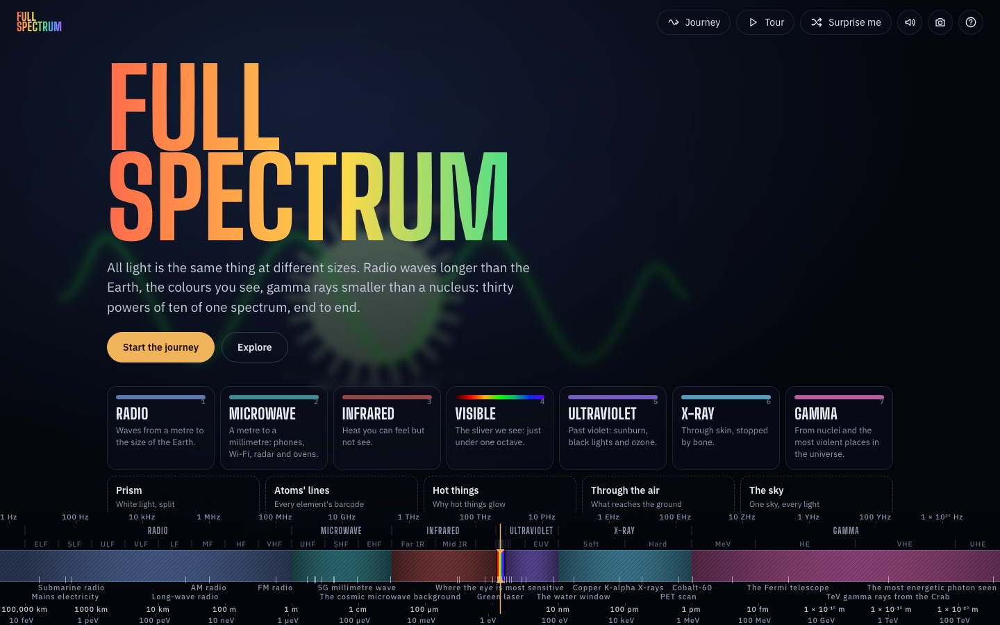
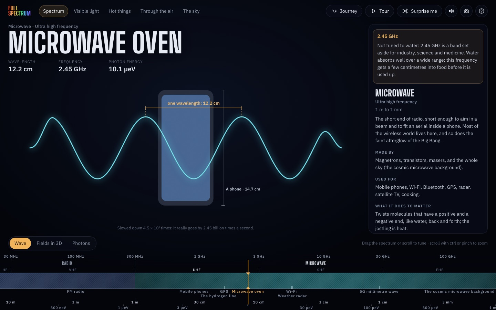
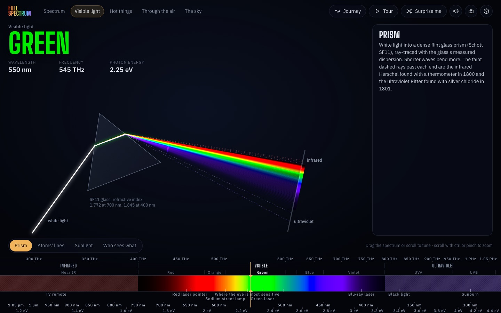
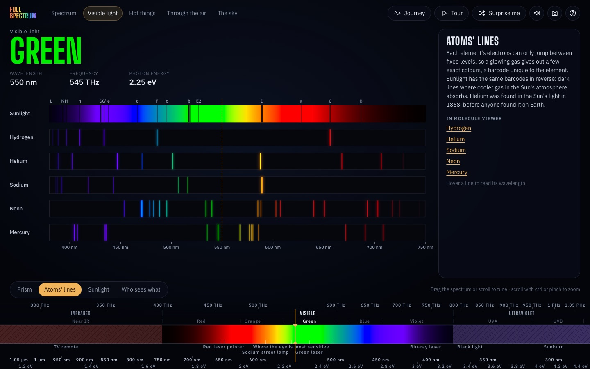
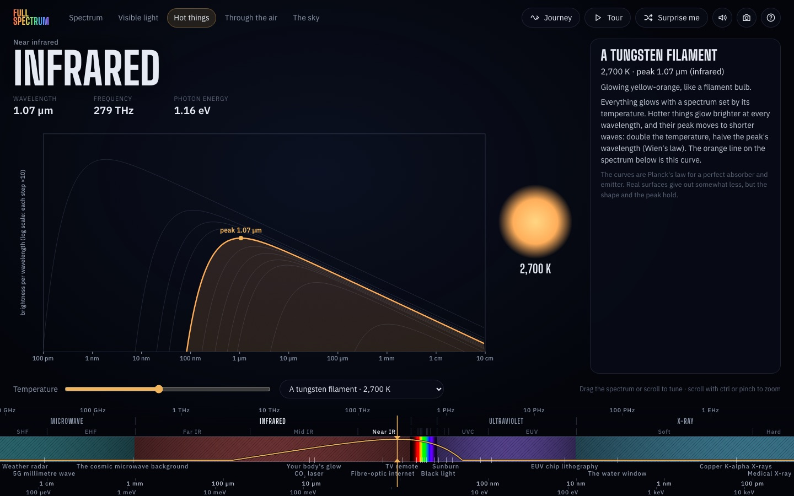
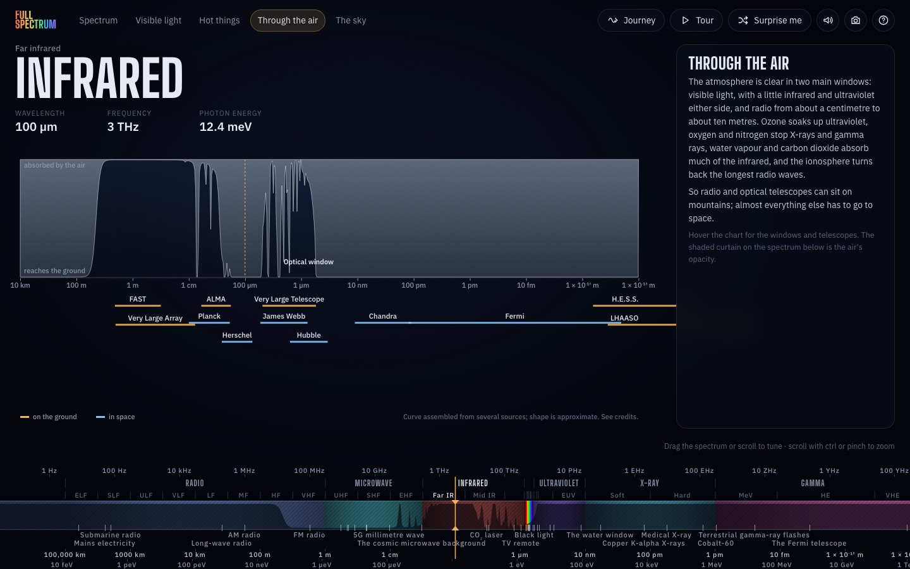
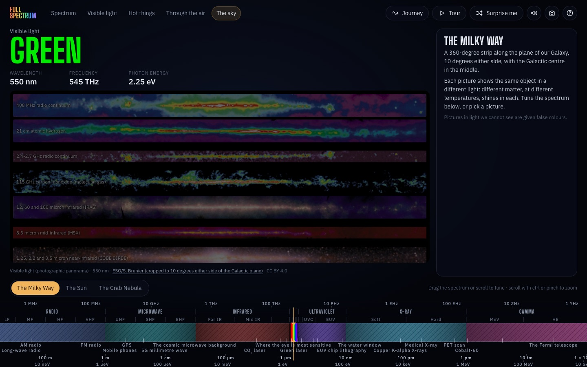

# Full Spectrum

The whole electromagnetic spectrum, end to end: radio waves longer than the Earth down to gamma rays
smaller than a nucleus, thirty powers of ten on one dial. Visible light is drawn in its real colours, every
wave is animated beside something of the same size, and each band says what makes it, what uses it and
what it does to matter.



| A wave beside a real thing | A prism, ray-traced | Atoms' lines |
| --- | --- | --- |
|  |  |  |

| Hot things | Through the air | The sky in every light |
| --- | --- | --- |
|  |  |  |

## What's in it

- **The dial.** The spectrum from 3 Hz to 12 PeV on a log scale, read through a fixed cursor like a radio
  dial: drag or scroll to tune, pinch or ctrl-scroll to zoom. Frequency, wavelength and photon energy are
  read off together, and you can type into any of them (`21 cm`, `2.45 GHz`, `511 keV`). Band and
  sub-band names (ITU radio bands, ISO 20473 infrared, ISO 21348 ultraviolet, X-ray and gamma) appear as
  they fit.
- **Real colour.** The visible band is computed from the CIE 1931 colour-matching functions, so its ends
  fade to dark as they do for the eye. Every other band is drawn in muted, hatched false colour that cannot be
  mistaken for it.
- **The wave at a scale you can feel.** The light at the cursor as a glowing travelling wave, beside a 3D
  model of the real thing nearest its size, lit and moving: Jupiter turning, Everest with snow blowing off
  the summit, the Eiffel Tower, a whale, an ant, a red blood cell, a flu virus with
  its spikes, a ribosome building a protein, the electron cloud of a hydrogen atom, a proton's quarks. Or as electric and magnetic fields in 3D (linear or circular polarisation), labelled and
  measured, with how strong the fields are in sunlight; or as photons: how many are in a metre of a 1 mW beam,
  and what one of them can do.
- **Forty real things at their wavelengths,** from the Schumann resonance to the 1.4 PeV photon LHAASO caught,
  by way of FM radio, the hydrogen line, microwave ovens, the cosmic microwave background, your body's glow,
  sodium lamps, sunburn, EUV chip lithography and PET scans.
- **Visible light, up close.** A prism of SF11 glass ray-traced with its measured dispersion; the emission
  lines of hydrogen, helium, sodium, neon and mercury against the Fraunhofer lines in sunlight; the Sun's
  spectrum above the air and at the ground against a 5772 K blackbody; human cone sensitivities and
  other animals' (bees, dogs, goldfish, mantis shrimp, pit vipers).
- **Hot things.** Planck's law from the cosmic microwave background (2.7 K) to the Sun's corona, with the
  peak, the colour it glows, how its power splits between infrared, visible, ultraviolet and X-rays, how much
  it gives out, and the curve laid over the dial.
- **Through the air.** What reaches the ground across the whole spectrum, what absorbs each stretch and why
  it matters for life and climate, the named windows, and twelve telescopes from FAST to LHAASO: where each
  is, what it is like, what it found, and why it has to be on a mountain or in space.
- **The sky in every light.** The Milky Way, the Sun and the Crab Nebula photographed across the spectrum;
  the picture follows the dial, and each one comes with what you are seeing, what its colours mean and where
  it was taken from.
- **Links to [Molecule Viewer](https://moleculeviewer.org)** for the molecules and elements each band acts on.
- **A journey** from the longest waves to the shortest, a tour through every view and mode, Surprise me, sound (each frequency shifted
  down by octaves until you can hear it), picture export, keyboard throughout (`?`), a phone layout, and an
  address for every place (`#nm-550`, `#ghz-2.45`, `#thing-cmb`, `#prism`, `#blackbody-5772`, `#sky-crab`).

## Run it

A static site with no build step. Serve the folder and open it:

```
python3 -m http.server 8123
```

then go to http://localhost:8123. (Opening `index.html` straight from disk will not work: browsers block
ES modules over `file://`.)

## Test it

```
npm install
npx playwright install chromium
npm test
```

`tests/physics.mjs` checks the physics, colour and data against known values (seconds).
`tests/smoke.mjs` serves the site and drives it in Chromium: every band and thing, the unit addresses,
typed values, all the views, the journey, tour and keyboard, dragging the dial and the phone layout. It
takes about five minutes, and any console error fails it. `node tools/shot.mjs` takes screenshots.

## How it's built

`index.html`, `css/app.css`, ES modules in `js/`, and three.js r170 from jsDelivr through an import map,
as in Molecule Viewer.

| File | What it does |
| --- | --- |
| `js/main.js` | Routing, the readout and details panel, view switching, journey, tour, keyboard, sound, pictures. |
| `js/physics.js` | Constants and formulas (λ, f, E, Planck, Wien, photon counts). Everything else asks here. |
| `js/colour.js` | CIE 1931 to sRGB: spectral colours and blackbody colours. |
| `js/bands.js`, `js/things.js` | The bands and sub-bands, and the real things along the spectrum. |
| `js/ribbon.js` | The dial. |
| `js/wave.js`, `js/scale.js`, `js/field3d.js` | The wave beside a real object, photons, and the 3D fields. |
| `js/wave3d.js`, `js/models3d.js` | The wave view's 3D layer (lighting, bloom) and the 30 models, textures drawn in code. |
| `js/visible.js`, `js/blackbody.js`, `js/atmosphere.js`, `js/sky.js` | The other views. |
| `js/journey.js`, `js/sound.js`, `js/links.js`, `js/format.js` | The journey's stops, sound, links to sibling sites, number formatting and parsing. |
| `data/*.js`, `assets/sky/`, `assets/models/` | Generated by `tools/`; do not edit by hand. |

## Data

Every dataset and image, with its exact source, citation and licence, is in
[docs/credits-spectral.md](docs/credits-spectral.md), [docs/credits-sky.md](docs/credits-sky.md) and
[docs/credits-models.md](docs/credits-models.md). In short:

- Colour: CIE 1931 2° colour-matching functions, CIE (2019) doi:10.25039/CIE.DS.xvudnb9b,
  **CC BY-SA 4.0** (so `data/cie1931.js` is CC BY-SA 4.0 too). Cone fundamentals: Stockman and Sharpe (2000), via CVRL.
- Spectral lines: NIST Atomic Spectra Database (SRD 78), © NIST, cited as NIST asks.
- Sunlight: ASTM G173-03 reference spectra, via the National Laboratory of the Rockies (formerly NREL).
- Atmosphere: assembled from ASTM G173, ATRAN models from Gemini Observatory (Lord 1992), and ITU-R P.676;
  approximate, and labelled so.
- Sky: NASA (Multiwavelength Milky Way, SDO, Chandra, Hubble, Spitzer, Fermi), ESO, ALMA, Hinode, NRAO and
  ESA/XMM-Newton, each credited as its owner asks.
- 3D models: ready-made ones from Poly Pizza, each credited under the picture with its author
  and licence (CC BY or CC0), fetched and slimmed by `tools/fetch_models.mjs`; the rest are modelled in code.
- Glass: Schott SF11 Sellmeier coefficients. Constants: CODATA 2018 exact SI values.
- Band edges: ITU-R V.431, ISO 20473, ISO 21348. They are conventions, and the panel says so.
- Software: [three.js](https://threejs.org) r170 (MIT). Fonts: Big Shoulders Display and IBM Plex Sans via
  Google Fonts (SIL Open Font License). Tests use Playwright (Apache 2.0); the model tools use glTF Transform (MIT), meshoptimizer (MIT) and sharp
  (Apache 2.0).

## About this project

Like [Molecule Viewer](https://github.com/danamini/molecule-viewer), this is an experiment in building with AI:
the code was written in conversation with Anthropic's Claude. The facts are sourced above so anyone can check
them, and corrections are welcome.
